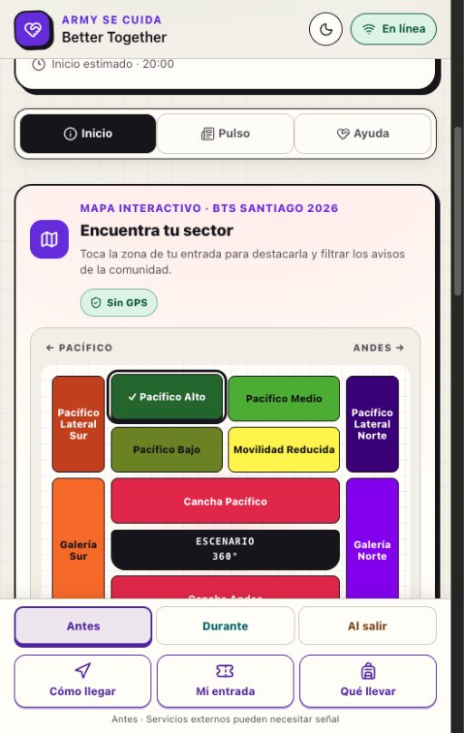
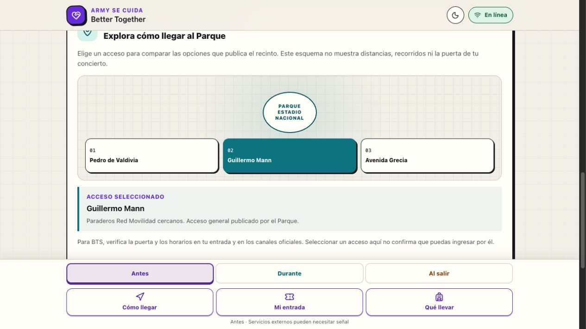

# Better Together

Experiencia móvil para orientar y acompañar a fans durante las tres sesiones de BTS en Santiago. Reúne información comprobable, un Pulse curado, actividades y una ayuda cotidiana acotada.

**Estado:** repositorio de código y prototipo de portafolio. Publicar este código no
despliega el Site ni habilita solicitudes, moderación, fuentes pagadas o automatizaciones.
Las fechas del evento ya pasaron; no debe usarse como servicio activo de asistencia.

## MVP

- Navegación independiente para las sesiones del 14, 16 y 17 de octubre de 2026.
- Fases y cuenta regresiva que identifican la hora como estimada.
- Información práctica, Pulse y actividades con fuente y fecha de revisión.
- Solicitudes cotidianas aisladas por sesión, con zonas aproximadas.
- Recepción pendiente de revisión y panel humano protegido para aprobar, rechazar y ocultar.
- Mapa interactivo de 16 sectores BTS, visible en Inicio, sin GPS, para elegir un sector y filtrar avisos.
- Guía visual independiente con los accesos generales Pedro de Valdivia, Guillermo Mann y Avenida Grecia al Parque Estadio Nacional.
- Cola local idempotente cuando no hay señal y descarte de solicitudes vencidas.
- Estados distintos para carga, vacío, error y contenido guardado.
- Métricas agregadas sin perfiles personales.
- Interfaz móvil, accesible y preparada para uso con una mano.

## Guía de llegada al Estadio Nacional

En Inicio aparece primero el mapa esquemático de los 16 sectores publicados en
[Ticketmaster](https://www.ticketmaster.cl/event/bts-world-tour-arirang-live-2026-scl).
Al elegir un sector, queda destacado, se guarda solo en el dispositivo y la vista de
Ayuda muestra sus avisos. El mapa es una interpretación visual original: no dibuja
puertas, recorridos ni distancias. Incluye enlaces al listado de sectores y a la
[guía oficial de DG Medios para BTS](https://info.dgmedios.com/content/uploads/2026/10/GUIA_BTS_WORLD_TOUR_ARIRANG_EN_SANTIAGO.pdf).



Debajo, la guía permite seleccionar uno de tres accesos generales publicados por el
[Parque Estadio Nacional](https://parqueestadionacional.cl/como-llegar). La tarjeta de
detalle y el estado seleccionado cambian juntos. El diagrama es original y esquemático:
no representa distancias, rutas, puertas ni la posición física de los accesos.

La guía de llegada es distinta del plano de sectores de la entrada. Para los conciertos
de BTS, [Ticketmaster](https://help.ticketmaster.cl/hc/es-cl/articles/45167383157905-BTS-WORLD-TOUR-ARIRANG)
indica que las instrucciones de acceso se comunican por los canales oficiales. La
selección en esta interfaz no asigna una puerta ni valida el ticket. Las tres fechas de
octubre de 2026 ya pasaron; el repositorio documenta un prototipo de portafolio y no
ofrece orientación operativa para un evento vigente.



### Criterios verificables

- Al elegir cualquiera de los tres accesos, el botón queda marcado y la tarjeta muestra su nombre y referencia de transporte.
- Los botones funcionan con teclado y muestran foco visible.
- La guía conserva enlaces separados a la fuente del Parque y a la información del evento.
- Ningún acceso se vincula a un sector o puerta de BTS sin fuente específica.
- El mapa de sectores está visible en Inicio; al elegir un sector cambia el filtro de Ayuda sin pedir ubicación exacta.
- El mapa enlaza la fuente de sectores y la guía oficial del evento sin atribuir puertas específicas al esquema.

## Desarrollo

Requiere Node.js 22.13 o superior.

```bash
npm install
npm run db:generate
npm test
npm run dev
```

Para la base local, genera primero el build y aplica las migraciones indicadas en `drizzle/` siguiendo la guía del starter.

## Flujo de trabajo

El desarrollo se realiza en ramas cortas, con Conventional Commits y PR con objetivo,
pruebas y vista previa. Cada incremento pasa compilación, pruebas y revisión móvil
antes de integrar a `main`. Publicación y permisos del Site se gestionan por separado.

## Moderación

El panel está en `/moderation`. Iniciar sesión con ChatGPT no basta: el servidor
debe incluir el ID estable de Sites en `MODERATOR_USER_IDS`. Por defecto la lista
está vacía y el acceso permanece cerrado. Usa `.env.example` como referencia;
no añadas IDs reales, correos ni secretos al repositorio o variables `NEXT_PUBLIC_*`.
El despliegue debe conservar el dispatcher autenticado de Sites.

Es una herramienta para moderadores humanos, no un agente atendiendo 24/7.
La primera prueba tendrá solo a Regina como responsable. Su ID real debe verificarse
desde su sesión en el Site: `/moderation` muestra únicamente la cuenta conectada
en el bloque privado «Ver mi cuenta para verificar el acceso». No uses la identidad
simulada de la vista previa ni habilites a todas las personas que pueden ver el Site.

## Protección de comunidad (antes de publicar)

- `COMMUNITY_HMAC_KEY`: secreto aleatorio de al menos 32 caracteres, solo servidor.
  Sin secreto válido los envíos nuevos y denuncias quedan cerrados con 503.
- El dispatcher identifica cuentas conectadas; visitantes anónimos reciben cookie
  HttpOnly/SameSite de 24 h. Solo se guardan claves HMAC, sin IP, correo ni nombre.
- Límite durable: 5 intentos nuevos de solicitudes / 10 min y 10 denuncias / 10 min
  por cuenta o cookie; techo compartido de 1000 / 10 min. Ventanas fijas: no son
  límites móviles estrictos. Reintentos ya recibidos no duplican ni renuevan contenido.
- La cookie anónima se puede borrar: esta protección básica NO sustituye defensas
  de red/CAPTCHA contra bots antes de abrir al público. Un exceso devuelve 429;
  la cola local se conserva y pausa los reintentos por 10 min.
- Denuncias sin texto libre, solo sobre solicitudes publicadas y vigentes. Una por
  cuenta/cookie y solicitud. No ocultan automáticamente. El panel prioriza denuncias
  y permite ocultar o mantener; mantener resuelve solo las denuncias de esa carga.
- No hay cola offline para denuncias ni promesa de moderación continua.

Retención aprobada: texto/alias se retiran 7 días después del vencimiento; denuncias
y decisiones con identificadores se eliminan a los 30 días desde su creación.
Los registros mínimos de solicitudes vencidas se eliminan a los 30 días desde
vencimiento cuando no quedan dependencias. Métricas se conservan hasta 30 días.
`DATA_RETENTION_ENABLED=false` por defecto: no se ha borrado información actual.
Actualizar el panel no elimina datos. La operación registrada del agente ejecuta
la limpieza únicamente al terminar correctamente un recorrido y con ambos controles
del servidor habilitados. La programación y su conexión aún deben verificarse antes
de activar estas funciones.

Lista de activación: verificar cuenta real → configurar secret y allowlist en Sites
→ aplicar migraciones en publicación controlada → verificar permisos, denuncias,
429 y limpieza → confirmar cobertura humana. No publicar ni cambiar la visibilidad
del Site solo porque el código se integró a `main`. Las migraciones se prueban localmente;
integrarlas no las aplica en producción.

## Documentación

- [Arquitectura](./ARCHITECTURE.md)
- [Contribuir](./CONTRIBUTING.md)
- [Seguridad](./SECURITY.md)

## Alcance de seguridad

Better Together complementa la coordinación comunitaria; no reemplaza al personal del recinto ni a los servicios de emergencia.
# Agente de moderación: primera capa en simulación

## Segundo incremento: ejecución protegida, aún sin activar

`POST /api/moderation/agent-cycle` recibe únicamente `{}`, exige la cuenta moderadora y el mismo origen/cabecera del panel. Sin `MODERATION_AGENT_ENABLED=true` en el servidor devuelve una simulación sin escrituras. Las opciones del cliente no pueden activarlo ni elegir decisiones.

Cuando se habilite, vuelve a consultar los datos y solo rechaza solicitudes pendientes u oculta solicitudes activas con los patrones de datos personales existentes. No aprueba contenido ni actúa por cantidad de denuncias. Otros indicios permanecen en la cola humana. Cada decisión usa la transacción y control de revisión del panel, con actor `agent:conservative-triage-v1:<cuenta-iniciadora>`; los reintentos no duplican decisiones y una revisión humana concurrente no se sobrescribe. Las reglas pueden tener falsos positivos y no detectan todo el odio, violencia o desinformación.

La limpieza requiere además `DATA_RETENTION_ENABLED=true`; no se ejecuta si falla una decisión del ciclo. Devuelve cantidades realmente modificadas sin copiar contenido. No se han habilitado estos controles en producción. Leer el panel no inicia limpieza.

El endpoint de navegador conserva una simulación/muestra de hasta 50 solicitudes.
La operación MCP descrita abajo añade el recorrido durable completo. Ningún endpoint
por sí solo establece una programación o promete moderación permanente.

La rama del agente añade `POST /api/moderation/agent-preview`, protegido por la misma cuenta moderadora y origen del panel. Recibe únicamente `{}` y devuelve códigos de revisión, identificadores y cantidades de limpieza; nunca copia los textos a la respuesta. Examina hasta 50 solicitudes vigentes, priorizando denuncias y solicitudes pendientes, e indica si la muestra es incompleta.

Es una clasificación conservadora por reglas, **no** un modelo semántico ni un verificador de noticias. Datos personales, indicios de seguridad, promoción y denuncias requieren revisión humana; no hay aprobación automática. La simulación solo consulta: no publica, oculta, registra decisiones ni borra datos, incluso al reintentar. Calcula la limpieza de texto 7 días después del vencimiento y de auditoría/denuncias a los 30 días. No representa vigilancia permanente.

Siguiente incremento: conectar una ejecución protegida y programada, verificar la identidad de Regina y probar acciones auditadas antes de habilitarla. No hay programación ni limpieza de producción activada por este endpoint. Esta rama se apoya en `feat/community-abuse-protection`; no debe integrarse sin su base.

## Operación desatendida: conexión pendiente de verificación

`POST /mcp` es un servidor HTTP sin sesión; Sites administra OAuth. La inicialización
y el listado de herramientas no incluyen datos privados. Todas las herramientas con
datos exigen identidad real y la misma lista `MODERATOR_USER_IDS`: un token de servicio
sin identidad no concede acceso. No se aceptan decisiones, identidades ni controles
de activación en los argumentos. Herramientas:

- `moderation_status`: controles activos y las diez ejecuciones recientes, sin contenido.
- `preview_moderation_cycle`: lectura sin escrituras; muestra parcial explícita.
- `run_moderation_cycle`: procesa hasta 50 por llamada con cursor persistente por fecha/ID,
  horizonte de recorrido y exclusión de ejecuciones concurrentes durante 120 segundos.
  Si `hasMore` es verdadero hay que continuar; al terminar reinicia el recorrido para
  incluir publicaciones nuevas o cambios en solicitudes ya revisadas.

Una ejecución con controles desactivados registra **solo metadatos operativos** y avanza
el cursor; no decide ni limpia. La simulación `preview_moderation_cycle` no escribe nada.
Las ejecuciones completas, parciales, fallidas e interrumpidas quedan registradas sin
alias, texto, correo ni mensajes internos de error. Un fallo no avanza el cursor.
Las decisiones previas conservan su auditoría y el reintento no las duplica. Los registros
operativos se eliminan a los 30 días únicamente cuando la retención está habilitada.

Para programar: publicar sin activar → conectar el plugin privado emitido por Sites
→ llamar a `moderation_status` con la cuenta autorizada → ejecutar un recorrido en modo
simulación y leer su registro persistido → verificar acceso en una tarea cloud nueva
→ crear/reutilizar programación vinculada al Site → activar moderación y comprobar
resultado → activar retención por separado. No incluir credenciales en instrucciones
ni cambiar la audiencia para hacer funcionar el proceso.

La tarea debe permanecer en silencio sin cambios relevantes y notificar fallos o
atención humana necesaria. Si falla la conexión/identidad, no intentar eludirla ni
prometer cobertura. La fuente pública de Pulso ARMY es un desarrollo separado.
